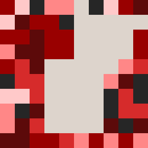
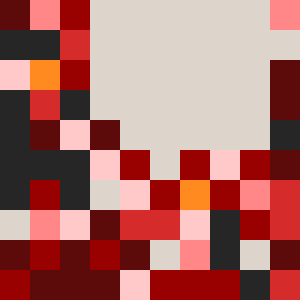
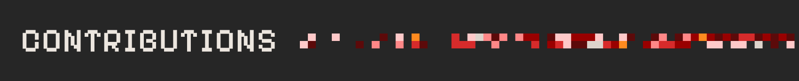
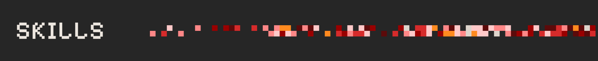
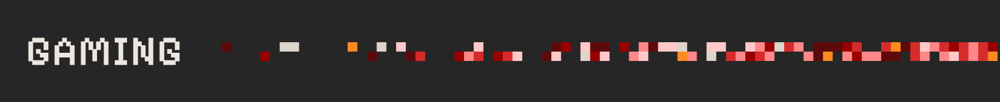

  

  

 

  

 

<table border="0" cellspacing="0" cellpadding="0">
  <tr>
    <td width="170" align="center">
      
    </td>
    <td align="center">
      <table border="0" cellspacing="0" cellpadding="8">
        <tr>
          <th>GitHub</th>
          <th>Website</th>
          <th>Instagram</th>
          <th>Hugging Face</th>
          <th>Email</th>
        </tr>
        <tr>
          <td align="center">   </td>
          <td align="center">   </td>
          <td align="center">   </td>
          <td align="center">   </td>
          <td align="center">   </td>
        </tr>
      </table>
    </td>
    <td width="170" align="center">
      
    </td>
  </tr>
</table>

 
 

  

  

 

  

 
 

  

  <table width="100%">
    <tr>
      <td align="center" width="12%"> HTML</td>
      <td align="center" width="12%"> Python</td>
      <td align="center" width="12%"> VS Code</td>
      <td align="center" width="12%"> GitHub</td>
      <td align="center" width="12%"> Vercel</td>
      <td align="center" width="12%"> Supabase</td>
      <td align="center" width="12%"> Cloudflare</td>
      <td align="center" width="12%"> WordPress</td>
    </tr>
    <tr>
      <td align="center"> Arch</td>
      <td align="center"> Kali</td>
      <td align="center"> Ubuntu</td>
      <td align="center"> Linux</td>
      <td align="center"> Windows</td>
      <td align="center"> PowerShell</td>
      <td align="center"> Vim</td>
      <td align="center"> Raspberry Pi</td>
    </tr>
    <tr>
      <td align="center"> Unreal</td>
      <td align="center"> Blender</td>
      <td align="center"> Figma</td>
      <td align="center"> Illustrator</td>
      <td align="center"> Photoshop</td>
      <td align="center"> Obsidian</td>
      <td align="center"> Discord</td>
      <td align="center"> Bots</td>
    </tr>
  </table>

 
 

  

  
  

  

