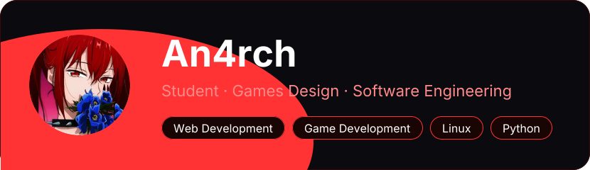
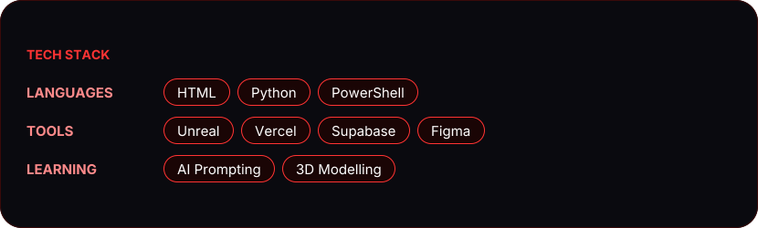

<p align="center">
<a href="https://github.com/an4rchuk"></a><a href="https://an4rch.uk"></a><a href="https://instagram.com/an4rchuk"></a><a href="https://huggingface.co/YOUR_HF_USERNAME"></a><a href="mailto:an4rch@an4rch.uk"></a>
</p>



## 🧑‍💻 A Little Bit About Me and My Interests

```yaml
name: An4rch
located_in: United Kingdom
current_job: Student
education:
  - "UAL Level 3 Diploma in Games Design"
company: An4rchUK - Personal Brand

fields_of_interests:
  - "Web Development"
  - "Game Development"
  - "Linux"
  - "Software"
  - "Coding"

currently_learning: ["HTML", "Python", "AI Prompting", "Vibe Coding", "Software Development", "3D Modelling"]
goals_2026: ["Learn about Software for my Software Engineering course at University"]
hobbies: ["Gaming", "Cinema", "Art", "Reading Manga", "Music"]
```

## 🚀 Some Tools I Have Used and Learned


## 📊 Commit Calendar


## 🎮 Steam


