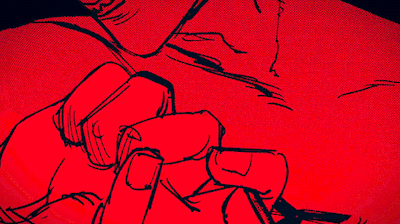

```aura width=860 height=200
(function() {
 var userName = github.user.name || github.user.login;
 var tags = ['Web Development', 'Game Development', 'Linux', 'Python'];

 return (
   <div style={{ width: '100%', height: '100%', background: '#08080c', display: 'flex', alignItems: 'center', fontFamily: 'Inter', position: 'relative', overflow: 'hidden', borderRadius: 16, border: '1px solid rgba(255,51,51,0.22)' }}>
     <style>
       {`
         @keyframes float-slow { 0%, 100% { transform: translateX(0px); opacity: 0.8; } 50% { transform: translateX(350px); opacity: 1.2; } }
         @keyframes float-medium { 0%, 100% { transform: translateX(0px); opacity: 0.7; } 50% { transform: translateX(-250px); opacity: 1.1; } }
         @keyframes float-fast { 0%, 100% { transform: translateX(0px); opacity: 0.9; } 50% { transform: translateX(200px); opacity: 0.6; } }
         @keyframes float-diagonal { 0%, 100% { transform: translate(0px, 0px); opacity: 0.75; } 50% { transform: translate(120px, 30px); opacity: 1.0; } }
         @keyframes float-wave { 0%, 100% { transform: translateX(0px); opacity: 0.65; } 33% { transform: translateX(-160px); opacity: 0.9; } 66% { transform: translateX(80px); opacity: 1.0; } }
         #glow-1 { animation: float-slow 8s ease-in-out infinite; }
         #glow-2 { animation: float-medium 12s ease-in-out infinite; }
         #glow-3 { animation: float-fast 9s ease-in-out infinite; }
         #glow-4 { animation: float-diagonal 10s ease-in-out infinite; }
         #glow-5 { animation: float-wave 13s ease-in-out infinite; }
       `}
     </style>

     <svg width="860" height="200" style={{ position: 'absolute', top: 0, left: 0 }}>
       <defs>
         <radialGradient id="r1" cx="50%" cy="50%" r="50%">
           <stop offset="0%" stopColor="rgba(255,40,40,0.65)" />
           <stop offset="45%" stopColor="rgba(180,0,0,0.25)" />
           <stop offset="70%" stopColor="rgba(180,0,0,0)" />
         </radialGradient>
         <radialGradient id="r2" cx="50%" cy="50%" r="50%">
           <stop offset="0%" stopColor="rgba(255,70,70,0.45)" />
           <stop offset="70%" stopColor="rgba(255,70,70,0)" />
         </radialGradient>
         <radialGradient id="r3" cx="50%" cy="50%" r="50%">
           <stop offset="0%" stopColor="rgba(200,20,20,0.35)" />
           <stop offset="70%" stopColor="rgba(200,20,20,0)" />
         </radialGradient>
         <radialGradient id="r4" cx="50%" cy="50%" r="50%">
           <stop offset="0%" stopColor="rgba(140,0,0,0.5)" />
           <stop offset="70%" stopColor="rgba(140,0,0,0)" />
         </radialGradient>
         <radialGradient id="r5" cx="50%" cy="50%" r="50%">
           <stop offset="0%" stopColor="rgba(255,30,30,0.4)" />
           <stop offset="70%" stopColor="rgba(255,30,30,0)" />
         </radialGradient>
       </defs>
       <ellipse id="glow-1" cx="180" cy="230" rx="260" ry="190" fill="url(#r1)" />
       <ellipse id="glow-2" cx="300" cy="240" rx="220" ry="160" fill="url(#r2)" />
       <ellipse id="glow-3" cx="420" cy="240" rx="180" ry="140" fill="url(#r3)" />
       <ellipse id="glow-4" cx="600" cy="250" rx="160" ry="120" fill="url(#r4)" />
       <ellipse id="glow-5" cx="760" cy="250" rx="140" ry="110" fill="url(#r5)" />
     </svg>

     <div style={{ display: 'flex', position: 'absolute', left: 48, top: 52, width: 96, height: 96, borderRadius: 48, background: 'linear-gradient(135deg, #ff3333, #660000)', alignItems: 'center', justifyContent: 'center' }}>
       
     </div>

     <div style={{ display: 'flex', flexDirection: 'column', marginLeft: 168, gap: 8, zIndex: 10 }}>
       <div style={{ display: 'flex', fontSize: 38, fontWeight: 800, color: '#ffffff', letterSpacing: '-1px', lineHeight: 1 }}>
         {userName}
       </div>
       <div style={{ display: 'flex', fontSize: 15, color: 'rgba(255,170,170,0.85)', fontWeight: 400 }}>
         {github.user.bio || 'Student · Games Design · Software Engineering'}
       </div>
       <div style={{ display: 'flex', gap: 8, marginTop: 6 }}>
         {tags.map(function(tag) {
           return (
             <div key={tag} style={{ display: 'flex', padding: '4px 12px', borderRadius: 20, background: 'rgba(255,51,51,0.15)', border: '1px solid rgba(255,51,51,0.4)', color: 'rgba(255,225,225,0.9)', fontSize: 12, fontWeight: 600 }}>{tag}</div>
           );
         })}
       </div>
     </div>
   </div>
 );
})()
```

```aura width=860 height=140
(function() {
 var stats = [
   { label: 'Repos', value: String(github.stats.totalRepos), color: '#ff5555' },
   { label: 'Stars', value: String(github.stats.totalStars), color: '#ff8a8a' },
   { label: 'Commits', value: String(github.stats.totalCommits), color: '#ffb3b3' },
 ];

 return (
   <div style={{ width: '100%', height: '100%', background: '#08080c', display: 'flex', alignItems: 'center', justifyContent: 'center', fontFamily: 'Inter', borderRadius: 16, border: '1px solid rgba(255,51,51,0.22)', position: 'relative', overflow: 'hidden' }}>
     <style>
       {`
         @keyframes float-slow { 0%, 100% { transform: translateX(0px); opacity: 0.8; } 50% { transform: translateX(350px); opacity: 1.2; } }
         @keyframes float-medium { 0%, 100% { transform: translateX(0px); opacity: 0.7; } 50% { transform: translateX(-250px); opacity: 1.1; } }
         @keyframes float-fast { 0%, 100% { transform: translateX(0px); opacity: 0.9; } 50% { transform: translateX(200px); opacity: 0.6; } }
         @keyframes float-diagonal { 0%, 100% { transform: translate(0px, 0px); opacity: 0.75; } 50% { transform: translate(120px, 30px); opacity: 1.0; } }
         @keyframes float-wave { 0%, 100% { transform: translateX(0px); opacity: 0.65; } 33% { transform: translateX(-160px); opacity: 0.9; } 66% { transform: translateX(80px); opacity: 1.0; } }
         #glow-1 { animation: float-slow 8s ease-in-out infinite; }
         #glow-2 { animation: float-medium 12s ease-in-out infinite; }
         #glow-3 { animation: float-fast 9s ease-in-out infinite; }
         #glow-4 { animation: float-diagonal 10s ease-in-out infinite; }
         #glow-5 { animation: float-wave 14s ease-in-out infinite; }
       `}
     </style>

     <svg width="860" height="140" style={{ position: 'absolute', top: 0, left: 0 }}>
       <defs>
         <radialGradient id="s1" cx="50%" cy="50%" r="50%">
           <stop offset="0%" stopColor="rgba(255,40,40,0.55)" />
           <stop offset="45%" stopColor="rgba(180,0,0,0.25)" />
           <stop offset="70%" stopColor="rgba(180,0,0,0)" />
         </radialGradient>
         <radialGradient id="s2" cx="50%" cy="50%" r="50%">
           <stop offset="0%" stopColor="rgba(255,70,70,0.4)" />
           <stop offset="70%" stopColor="rgba(255,70,70,0)" />
         </radialGradient>
         <radialGradient id="s3" cx="50%" cy="50%" r="50%">
           <stop offset="0%" stopColor="rgba(200,20,20,0.4)" />
           <stop offset="70%" stopColor="rgba(200,20,20,0)" />
         </radialGradient>
         <radialGradient id="s4" cx="50%" cy="50%" r="50%">
           <stop offset="0%" stopColor="rgba(255,90,90,0.3)" />
           <stop offset="70%" stopColor="rgba(255,90,90,0)" />
         </radialGradient>
         <radialGradient id="s5" cx="50%" cy="50%" r="50%">
           <stop offset="0%" stopColor="rgba(140,0,0,0.4)" />
           <stop offset="70%" stopColor="rgba(140,0,0,0)" />
         </radialGradient>
       </defs>
       <ellipse id="glow-1" cx="710" cy="150" rx="210" ry="150" fill="url(#s1)" />
       <ellipse id="glow-2" cx="550" cy="140" rx="190" ry="140" fill="url(#s2)" />
       <ellipse id="glow-3" cx="400" cy="130" rx="170" ry="130" fill="url(#s3)" />
       <ellipse id="glow-4" cx="250" cy="140" rx="150" ry="120" fill="url(#s4)" />
       <ellipse id="glow-5" cx="100" cy="150" rx="130" ry="110" fill="url(#s5)" />
     </svg>

     {stats.map(function(s, i) {
       return (
         <div key={s.label} style={{ flexGrow: 1, display: 'flex', flexDirection: 'column', alignItems: 'center', justifyContent: 'center', padding: '16px 8px', borderRight: i < stats.length - 1 ? '1px solid rgba(255,255,255,0.06)' : 'none', gap: 5 }}>
           <div style={{ display: 'flex', fontSize: 30, fontWeight: 800, color: s.color, lineHeight: 1 }}>
             {s.value}
           </div>
           <div style={{ display: 'flex', fontSize: 11, color: 'rgba(255,200,200,0.45)', fontWeight: 600, letterSpacing: '1.5px' }}>
             {s.label.toUpperCase()}
           </div>
         </div>
       );
     })}
   </div>
 );
})()
```

```aura width=860 height=168
(function() {
 var topLangs = github.languages.slice(0, 6).map(function(l) { return l.name; });
 var categories = [
   { title: 'Languages', color: '#ff5555', items: topLangs },
   { title: 'Tools', color: '#ff8a8a', items: ['Unreal', 'Vercel', 'Supabase', 'Figma'] },
 ];

 return (
   <div style={{ width: '100%', height: '100%', background: '#08080c', display: 'flex', flexDirection: 'column', fontFamily: 'Inter', padding: '18px 32px', gap: 14, borderRadius: 16, border: '1px solid rgba(255,51,51,0.22)', position: 'relative', overflow: 'hidden' }}>
     <style>
       {`
         @keyframes float-slow { 0%, 100% { transform: translateX(0px); opacity: 0.8; } 50% { transform: translateX(350px); opacity: 1.2; } }
         @keyframes float-medium { 0%, 100% { transform: translateX(0px); opacity: 0.7; } 50% { transform: translateX(-250px); opacity: 1.1; } }
         @keyframes float-fast { 0%, 100% { transform: translateX(0px); opacity: 0.9; } 50% { transform: translateX(200px); opacity: 0.6; } }
         @keyframes float-diagonal { 0%, 100% { transform: translate(0px, 0px); opacity: 0.75; } 50% { transform: translate(120px, 30px); opacity: 1.0; } }
         @keyframes float-wave { 0%, 100% { transform: translateX(0px); opacity: 0.65; } 33% { transform: translateX(-160px); opacity: 0.9; } 66% { transform: translateX(80px); opacity: 1.0; } }
         #glow-1 { animation: float-slow 9s ease-in-out infinite; }
         #glow-2 { animation: float-medium 12s ease-in-out infinite; }
         #glow-3 { animation: float-fast 8s ease-in-out infinite; }
         #glow-4 { animation: float-diagonal 11s ease-in-out infinite reverse; }
         #glow-5 { animation: float-wave 14s ease-in-out infinite reverse; }
       `}
     </style>

     <svg width="860" height="168" style={{ position: 'absolute', top: 0, left: 0 }}>
       <defs>
         <radialGradient id="t1" cx="50%" cy="50%" r="50%">
           <stop offset="0%" stopColor="rgba(255,40,40,0.55)" />
           <stop offset="42%" stopColor="rgba(180,0,0,0.25)" />
           <stop offset="70%" stopColor="rgba(180,0,0,0)" />
         </radialGradient>
         <radialGradient id="t2" cx="50%" cy="50%" r="50%">
           <stop offset="0%" stopColor="rgba(255,70,70,0.4)" />
           <stop offset="70%" stopColor="rgba(255,70,70,0)" />
         </radialGradient>
         <radialGradient id="t3" cx="50%" cy="50%" r="50%">
           <stop offset="0%" stopColor="rgba(200,20,20,0.38)" />
           <stop offset="70%" stopColor="rgba(200,20,20,0)" />
         </radialGradient>
         <radialGradient id="t4" cx="50%" cy="50%" r="50%">
           <stop offset="0%" stopColor="rgba(255,90,90,0.3)" />
           <stop offset="70%" stopColor="rgba(255,90,90,0)" />
         </radialGradient>
         <radialGradient id="t5" cx="50%" cy="50%" r="50%">
           <stop offset="0%" stopColor="rgba(140,0,0,0.4)" />
           <stop offset="70%" stopColor="rgba(140,0,0,0)" />
         </radialGradient>
       </defs>
       <ellipse id="glow-1" cx="170" cy="168" rx="260" ry="170" fill="url(#t1)" />
       <ellipse id="glow-2" cx="320" cy="178" rx="220" ry="140" fill="url(#t2)" />
       <ellipse id="glow-3" cx="460" cy="178" rx="190" ry="130" fill="url(#t3)" />
       <ellipse id="glow-4" cx="590" cy="188" rx="160" ry="110" fill="url(#t4)" />
       <ellipse id="glow-5" cx="750" cy="188" rx="140" ry="100" fill="url(#t5)" />
     </svg>

     <div style={{ display: 'flex', fontSize: 10, fontWeight: 700, color: 'rgba(255,160,160,0.6)', letterSpacing: '3px' }}>
       TECH STACK
     </div>
     <div style={{ display: 'flex', flexDirection: 'column', gap: 14 }}>
       {categories.map(function(cat) {
         return (
           <div key={cat.title} style={{ display: 'flex', alignItems: 'center', gap: 16 }}>
             <div style={{ display: 'flex', fontSize: 10, fontWeight: 700, color: cat.color, letterSpacing: '1px', width: 80 }}>
               {cat.title.toUpperCase()}
             </div>
             <div style={{ display: 'flex', flexWrap: 'wrap', gap: 7 }}>
               {cat.items.map(function(item) {
                 return (
                   <div key={item} style={{ display: 'flex', padding: '4px 13px', borderRadius: 6, background: 'rgba(255,51,51,0.12)', border: '1px solid rgba(255,51,51,0.35)', color: 'rgba(255,235,235,0.9)', fontSize: 12, fontWeight: 600 }}>{item}</div>
                 );
               })}
             </div>
           </div>
         );
       })}
     </div>
   </div>
 );
})()
```

```aura width=150 height=44 link="https://github.com/an4rchuk" inline align=center
<div style={{ display: 'flex', position: 'relative', width: '100%', height: '100%', background: '#000000', border: '2px solid #ff3333', borderRadius: 22 }}>
  <div style={{ display: 'flex', position: 'absolute', top: 0, left: 0, right: 0, bottom: 0, alignItems: 'center', justifyContent: 'center', color: '#ffffff', fontSize: 16, fontWeight: 700, lineHeight: 1 }}>GitHub</div>
</div>
```

```aura width=150 height=44 link="https://an4rch.uk" inline align=center
<div style={{ display: 'flex', position: 'relative', width: '100%', height: '100%', background: '#000000', border: '2px solid #ff3333', borderRadius: 22 }}>
  <div style={{ display: 'flex', position: 'absolute', top: 0, left: 0, right: 0, bottom: 0, alignItems: 'center', justifyContent: 'center', color: '#ffffff', fontSize: 16, fontWeight: 700, lineHeight: 1 }}>Website</div>
</div>
```

```aura width=150 height=44 link="https://instagram.com/an4rchuk" inline align=center
<div style={{ display: 'flex', position: 'relative', width: '100%', height: '100%', background: '#000000', border: '2px solid #ff3333', borderRadius: 22 }}>
  <div style={{ display: 'flex', position: 'absolute', top: 0, left: 0, right: 0, bottom: 0, alignItems: 'center', justifyContent: 'center', color: '#ffffff', fontSize: 16, fontWeight: 700, lineHeight: 1 }}>Instagram</div>
</div>
```

```aura width=150 height=44 link="https://huggingface.co/an4rchuk" inline align=center
<div style={{ display: 'flex', position: 'relative', width: '100%', height: '100%', background: '#000000', border: '2px solid #ff3333', borderRadius: 22 }}>
  <div style={{ display: 'flex', position: 'absolute', top: 0, left: 0, right: 0, bottom: 0, alignItems: 'center', justifyContent: 'center', color: '#ffffff', fontSize: 16, fontWeight: 700, lineHeight: 1 }}>Hugging Face</div>
</div>
```

```aura width=150 height=44 link="mailto:an4rch@an4rch.uk" inline align=center
<div style={{ display: 'flex', position: 'relative', width: '100%', height: '100%', background: '#000000', border: '2px solid #ff3333', borderRadius: 22 }}>
  <div style={{ display: 'flex', position: 'absolute', top: 0, left: 0, right: 0, bottom: 0, alignItems: 'center', justifyContent: 'center', color: '#ffffff', fontSize: 16, fontWeight: 700, lineHeight: 1 }}>Email</div>
</div>
```

🔨 Currently building: AN4RCH OS, a custom Arch Linux distro

## 🧑‍💻 A Little Bit About Me and My Interests

```yaml
name: An4rch
located_in: United Kingdom
current_job: Student
education:
  - "UAL Level 3 Diploma in Games Design"
company: An4rchUK - Personal Brand

fields_of_interests:
  - "Web Development"
  - "Game Development"
  - "Linux"
  - "Software"
  - "Coding"

currently_learning: ["HTML", "Python", "AI Prompting", "Vibe Coding", "Software Development", "3D Modelling"]
goals_2026: ["Learn about Software for my Software Engineering course at University"]
hobbies: ["Gaming", "Cinema", "Art", "Reading Manga", "Music"]
```

## 🚀 Some Tools I Have Used and Learned




## 📊 Commit Calendar


## 🎮 Steam


